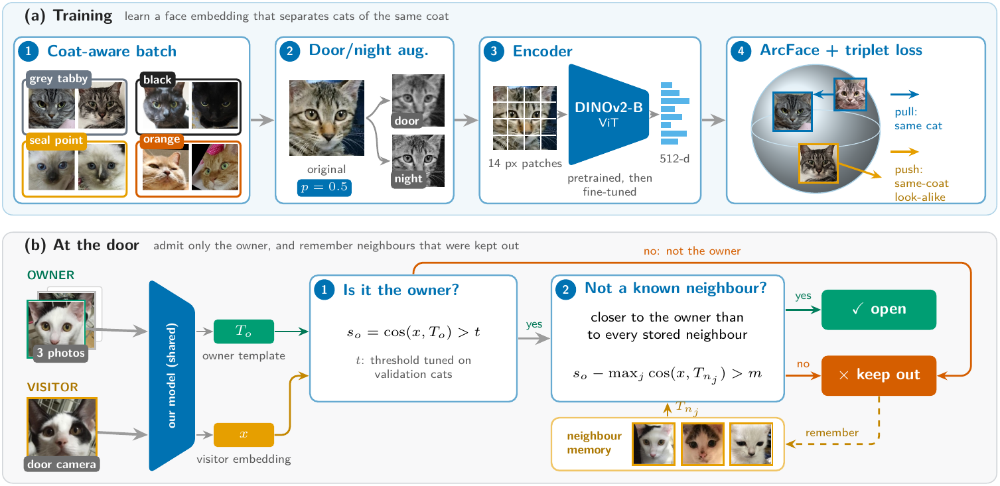
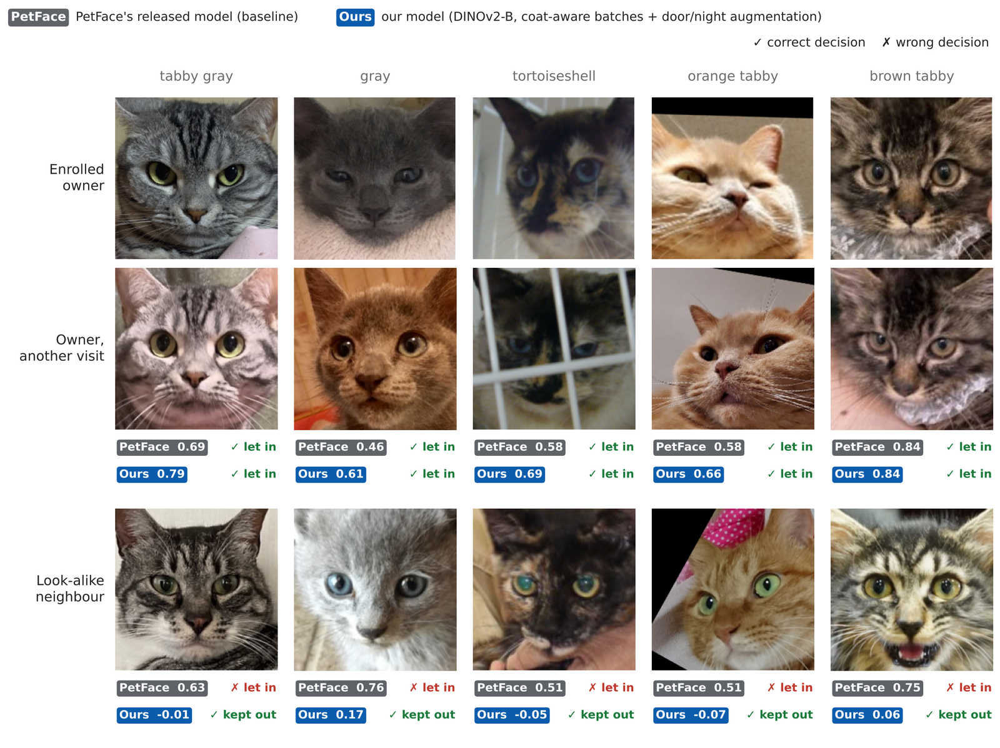

# WhoCat: telling look-alike cats apart at the door

A face-recognising cat flap has to keep out the neighbour's cat, and the neighbour's cat often has the same coat as yours.
WhoCat measures how often cat face models get this wrong, trains a model that gets it wrong less often, and adds a door rule that remembers the neighbours it has already turned away.

**Papers:** [CENG580 final report (PDF)](paper/WhoCat_CENG580_final_report.pdf) · [CSBP441 report (PDF)](paper/WhoCat_CSBP441_report.pdf)
**Live demo:** test the door with your own cat's photos or webcam in about five minutes, no training needed ([try it](#try-the-live-demo))



## Results

All numbers are on 34,083 PetFace test cats that no model saw in training. TAR@FAR=1% is the share of owner photos accepted when 1% of strangers get in.

| Model | AUC, official pairs | Random stranger | Same coat | Look-alike | Look-alike, door camera | Look-alike, night |
|---|---:|---:|---:|---:|---:|---:|
| MegaDescriptor-L | 88.23 | 45.4 | 32.5 | 18.1 | 4.9 | 3.6 |
| DINOv2-B, frozen | 95.58 | 64.6 | 46.5 | 26.6 | 10.6 | 14.3 |
| PetFace ResNet-50 | 97.71 | 86.7 | 79.0 | 59.1 | 31.9 | 31.3 |
| **WhoCat (ours)** | **98.44** | **91.8** | **88.4** | **74.1** | **65.1** | **70.3** |
| WhoCat small (MobileNetV3, 4.9M params) | 97.95 | 87.1 | 79.9 | 57.6 | 42.9 | 51.0 |

The whole door, on 3,593 validation homes, each visited by its owner and three look-alike neighbours:

| Door | Owner visits let in | Look-alike visits let in |
|---|---:|---:|
| PetFace model, threshold set on random cats | 85.6% | 20.3% |
| Our model, threshold set on random cats | 92.0% | 20.1% |
| + threshold tuned on look-alikes | 73.5% | 1.04% |
| + neighbour memory | 72.3% | 0.27% |
| **+ 3 enrolment photos (full door rule)** | **82.3%** | **0.39%** |
| PetFace model with the full door rule | 67.7% | 0.46% |

What we found:

- **Random-pair accuracy hides the problem.** Every model loses 18–38 points when the stranger is a look-alike, and a threshold set on random cats lets in 13–25% of look-alikes whatever the model.
- **Coat-aware batches only work with augmentation.** On their own they teach a lighting shortcut (look-alike TAR falls to 56.4%, and to 10.2% at night). With door/night augmentation they beat random batches by 7–9 points, on DINOv2 and on MobileNetV3.
- **It is lighting, not background.** Changing only brightness and white balance costs the un-augmented model 10.7 points; a model trained to ignore the background is no better on look-alikes.
- **Remembering neighbours works.** Rejecting a visitor that looks more like a known neighbour than like the owner cuts look-alike entries by four times, with no training.



## Try the live demo

A front-door simulator: enrol a cat from one to three photos (webcam or files), then show it visitors and watch two doors decide side by side, with every score and threshold. It runs on a normal laptop; no GPU, no dataset and no training needed.

**You need:** Python 3.10 or newer ([python.org](https://www.python.org/downloads/); on Windows tick "Add python.exe to PATH" in the installer), Chrome or Edge, and about 2 GB of disk space.

**1. Get the code** (or click **Code → Download ZIP** on this page and unzip it):

```
git clone https://github.com/mustafanfj/WhoCat.git
cd WhoCat
```

**2. Install the packages** (a few minutes, once):

```
pip install -r demo/requirements.txt
```

**3. Download our trained model** (once; it goes into a `checkpoints` folder inside `WhoCat`):

```
python demo/get_weights.py
```

**4. Start the demo:**

```
python demo/server.py
```

Wait for `WhoCat demo on http://localhost:8123`, then open **http://localhost:8123** in Chrome or Edge. Use exactly that address: browsers only allow the camera on `localhost`. Stop the demo with Ctrl+C.

**5. Use it:** click **Take a photo** (or **Upload**) and enrol your cat with one to three face photos, eyes towards the camera. Then press **Photo a visitor** and show it your cat on another day, or a different cat (a photo of a cat on a phone screen works too). Each door says whether it opens and why. If a visitor is a different cat, press **Remember as a neighbour**: the WhoCat door then keeps out cats that look more like that neighbour than like yours. The **Scoreboard** gives the results on 3,593 validation homes, and **Door camera** shows each photo as a blurry, dim door camera would.

On Windows, if `python` is not found, use `py` instead (`py demo/server.py`). If `pip` fails on macOS or Linux, use `python3 -m pip install -r demo/requirements.txt` and `python3` in the other commands.

**Optional extras.** These need PetFace's research-only licence, so they are not in this repository:
- *PetFace's door:* download PetFace's released cat model from [github.com/mapooon/PetFace](https://github.com/mapooon/PetFace) and save it as `checkpoints/petface/cat.pt`. The demo then compares PetFace's model with ours on every photo.
- *Sample homes and guided tour:* 12 held-out PetFace homes with a five-scene tour. They are built from the dataset with `python demo/export_bundle.py` (needs the PetFace data and our embedding caches) and go in `demo/web/bundle/`.

Everything is computed on your computer; photos are never saved or sent anywhere. More detail in [demo/README.md](demo/README.md).

## Reproducing the paper

The code expects this layout (or set `WHOCAT_ROOT` to the project folder):

```
project/
  code/          this repository
  data/PetFace/  images/cat/<id>/*.png, split/cat/*, annotations/cat.csv
  checkpoints/   petface/cat.pt (PetFace's released cat model) and our training runs
  outputs/       written by the scripts: index, embedding caches, protocols, results, figures
```

PetFace is available from its authors for non-commercial research ([PetFace, ECCV 2024](https://dahlian00.github.io/PetFacePage/)).

```bash
git clone https://github.com/mustafanfj/WhoCat.git code
cd code && bash setup.sh          # virtualenv + requirements (expects PyTorch with CUDA)
source ../env.sh                  # in every new shell
```

| Step | Command | What it does |
|---|---|---|
| baselines | `bash run_baselines.sh` | steps 01–06 for PetFace, MegaDescriptor and DINOv2 |
| 01 | `python scripts/01_index.py` | index the splits and images |
| 02 | `python scripts/02_coat_labels.py` | coat labels and image hashes |
| 04 | `python scripts/04_protocols.py` | build the protocols (random, same-coat, look-alike, Face ID) |
| 03 | `python scripts/03_embed.py --models petface megadesc dinov2` | cache embeddings for clean, door and night probes |
| 05 | `python scripts/05_evaluate.py` | verification tables, leak, Face ID |
| 06 | `python scripts/06_stranger_enrollment.py` | neighbour memory on test homes |
| train | `bash run_training.sh`, `bash run_training2.sh` | random vs coat-aware batches, with and without augmentation, background swap, small model |
| 10–13 | `scripts/10_score_norm.py` … `13_shortcut_tests.py` | score normalisation, fusion, the whole door, shortcut tests |
| 15 | `python scripts/15_occlusion.py` | occlusion maps |

Our runs used one training seed (0); results for every experiment are in [`results/`](results/) (`summary_trained.md` is the main table, `summary_door.md` the door ladder, `summary_shortcuts.md` the shortcut tests).
`edge/` and `scripts/16_export_edge.py` hold work in progress on running exported models on small devices; they are not part of the reports.

## Repository

```
whocat/      library: data, protocols, samplers, losses, degradations, models, metrics
scripts/     numbered experiment scripts and train.py
demo/        door simulator: web page, bundle exporter, live server
results/     result tables (CSV and Markdown) behind every number in the papers
figures/     figures from the papers
paper/       the two reports (PDF)
edge/        work in progress, not in the reports
```

## Authors

CENG580 (Group 5): Mustafa Al Juboori, Mohamed Abdulla Khalfan Almazrouei, Obaid Juma Selayem Alharthi, Suhail Ahmed Abdulla Alblooshi.
CSBP441 (Group 5): Mustafa Al Juboori, Tahnoon Abdulla Khalfan Almazrouei, Mohamed Jumah Abdulla Alqaydi, Ali Nasser Alghaithi.
United Arab Emirates University, 2026.

## Licence

Code: MIT (see [LICENSE](LICENSE)). The PetFace dataset and model weights keep their own non-commercial research licence; the example faces in the figures come from PetFace.
